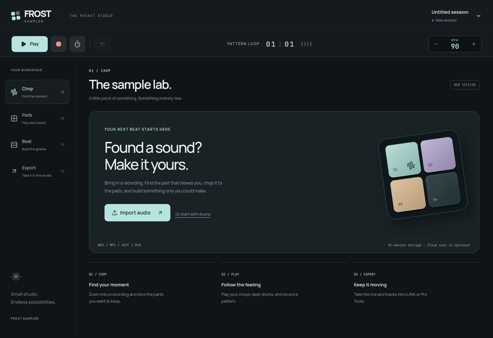
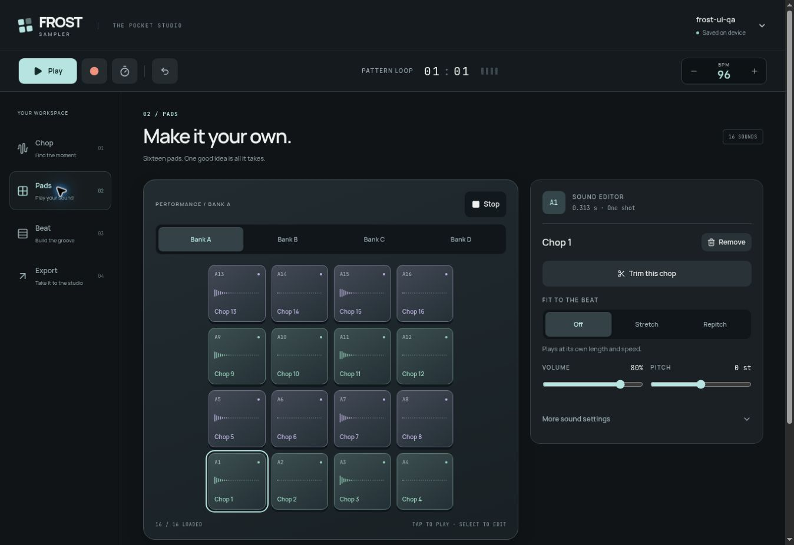
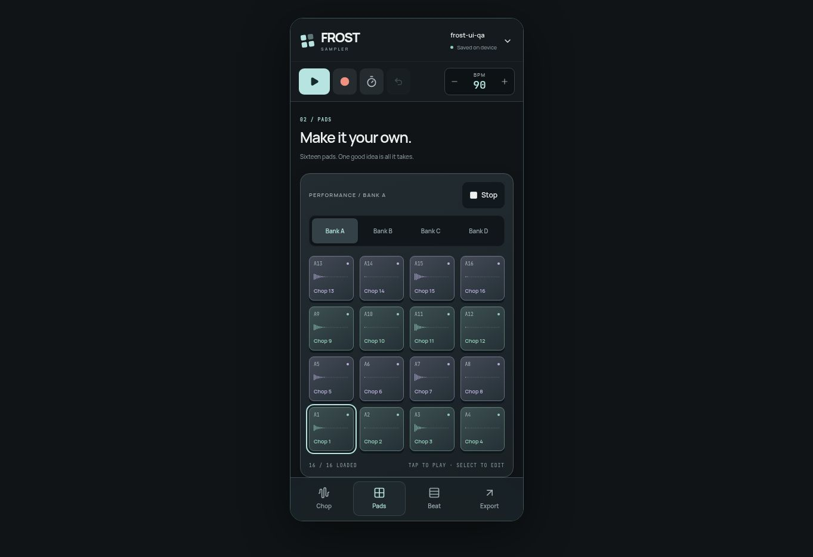

# Frost studio interface redesign

This redesign updates the shipping React sampler in `src/components/frost`. It gives the instrument a graphite and ice-blue identity, distinct transport controls, tactile pads, and clearer navigation across Chop, Pads, Beat, and Export.

## What changes

- FROST wordmark and pad-based brand mark, Manrope typography, consistent surfaces, focus rings, reduced-motion support, and matching browser theme colors.
- Desktop workspace rail and mobile bottom navigation. Project selection and actual device-save status remain in the header.
- Persistent play, record, metronome, undo, and editable BPM controls. Desktop transport position and beat indicators read the real transport state.
- Guided empty import screen with direct access to the existing drum workflow.
- Clearer waveform workspace, sound editor, groove controls, and export format summary.
- Pads show actual slice waveform peaks from `audioStore`, plus selected and held states. Empty and unloaded sounds remain distinct. Pad numbering and bank order are retained.
- Keyboard Space/Enter pad activation, pointer capture/release handling, accessible pad labels, pressed states, and current navigation indication.

The audio engine, project schema, Cloud/MCP routes, AI consent gate, and native SwiftUI implementation are not modified. The current `ios/README.md` identifies the web app as the shipping instrument. This is not a completed native iPhone redesign.

## Validation

- `npx tsc --noEmit` — pass.
- `npm test` — 59 tests passed across 7 files.
- `npm run build` — production client/server build passed. The existing large-chunk warning remains.
- `git diff --check` — pass.
- Browser workflow with a generated 5-second, 96 BPM WAV: import, equal chop into 16 slices, assign to bank A, keyboard pad activation, enter 96 BPM, create a four-hit pattern, start/stop transport, render stereo mix and pad track.
- Export screen produced two 24-bit 48 kHz WAVs, approximately 6.3 MB each, with displayed peak of -10.2 dBFS.
- Visual review at desktop width and in a 390 × 844 CSS-pixel iframe. All 16 loaded pads are visible in the phone-sized view. This is Chromium layout verification, not iOS/Safari or physical touch/latency validation.
- Test data stays in the preview browser; no production projects were edited and no AI calls were made.

## Screenshots

Screenshots show the implementation running in the browser. Loaded-pad screenshots use the generated QA recording.

## Device review prompt

Review this branch on a real iPhone in Safari and Home Screen mode before merging. Check notch and bottom safe areas, portrait and landscape scrolling, four-bank navigation, simultaneous pad touches, hold/release/cancel behavior, typing BPM, project switching, import/chop, recording, and WAV export. Confirm existing saved projects reopen correctly. Keep fixes scoped to this interface; preserve the engine, schema, Cloud/MCP protections, and AI-consent flow. Report exact device/OS, results, and any screenshots before publishing.
