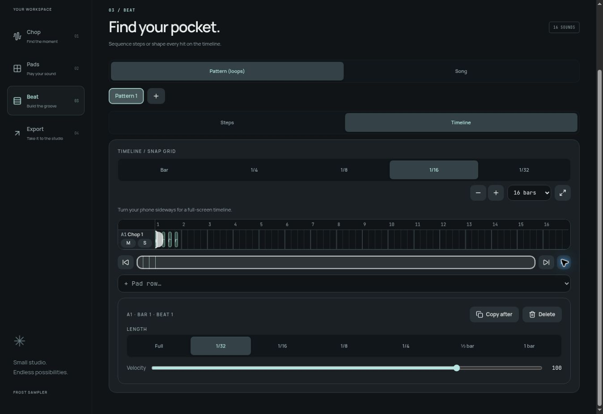
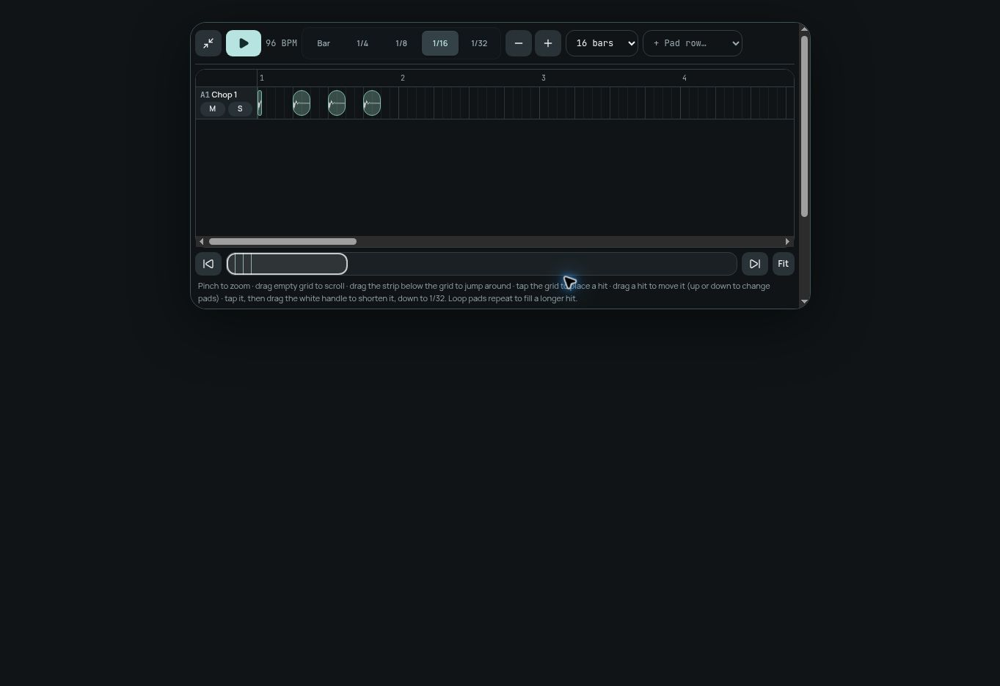

# Frost studio interface redesign

This redesign updates the shipping React sampler in `src/components/frost`. It gives the instrument a graphite and ice-blue identity, distinct transport controls, tactile pads, and clearer navigation across Chop, Pads, Beat, and Export.

## What changes

- FROST wordmark and pad-based brand mark, Manrope typography, consistent surfaces, focus rings, reduced-motion support, and matching browser theme colors.
- Desktop workspace rail and mobile bottom navigation. Project selection and actual device-save status remain in the header.
- Persistent play, record, metronome, undo, and editable BPM controls. Desktop transport position and beat indicators read the real transport state.
- Guided empty import screen with direct access to the existing drum workflow.
- Clearer waveform workspace, sound editor, groove controls, and export format summary.
- Pads show actual slice waveform peaks from `audioStore`, plus selected and held states. Empty and unloaded sounds remain distinct. Pad numbering and bank order are retained.
- Keyboard Space/Enter pad activation, pointer capture/release handling, accessible pad labels, pressed states, and current navigation indication.

This branch incorporates Claude’s merged PRs #12 and #13 through main commit `6353921`. Relative to that main revision, the audio engine, project schema, Cloud/MCP routes, AI consent gate, and native SwiftUI implementation are not modified. The current `ios/README.md` identifies the web app as the shipping instrument. This is not a completed native iPhone redesign.

## Claude functionality included

| Feature | Design integration |
| --- | --- |
| Steps / Timeline modes | Both stay in Beat, with updated workspace guidance and shared surfaces. |
| Waveform hits, exact placement, length down to 1/32 | Original edit, drag, resize, copy, velocity, mute and solo behavior retained; hit inspector uses studio styling. |
| Patterns up to 128 bars and Song → Timeline | Existing length choices and conversion remain available; original patterns are preserved by Claude’s conversion. |
| Pinch zoom, grid pan, overview strip, start/end/Fit | Navigation remains intact, with matching control styling. |
| Landscape full-screen timeline | Compact toolbar, safe-area padding, dedicated transport, and notices above the editor. |
| Playback, export and MCP | Claude’s exact-hit/length semantics, half-step hits and song-to-timeline tools retained unchanged. |

## Validation

- `npx tsc --noEmit` — pass.
- `npm test` — 62 tests passed across 7 files.
- `npm run build` — production client/server build passed. The existing large-chunk warning remains.
- `git diff --check` — pass.
- Browser workflow with a generated 5-second, 96 BPM WAV: import, equal chop into 16 slices, assign to bank A, keyboard pad activation, enter 96 BPM, create a four-hit pattern, start/stop transport, render stereo mix and pad track.
- Export screen produced two 24-bit 48 kHz WAVs, approximately 6.3 MB each, with displayed peak of -10.2 dBFS.
- Visual review at desktop width and in a 390 × 844 CSS-pixel iframe. All 16 loaded pads are visible in the phone-sized view. This is Chromium layout verification, not iOS/Safari or physical touch/latency validation.
- Integration browser checks: switched to Timeline, chose 16 bars, selected a hit and set its length to 1/32, used zoom and Fit, and verified automatic full-screen mode with transport and overview controls in an 844 × 390 landscape iframe. Pinch gestures and physical touch remain device-review items.
- Test data stays in the preview browser; no production projects were edited and no AI calls were made.

## Screenshots

Screenshots show the implementation running in the browser. Loaded-pad screenshots use the generated QA recording.

## Device review prompt

Review this branch on a real iPhone in Safari and Home Screen mode before merging. Check notch and bottom safe areas, portrait and landscape scrolling, four-bank navigation, simultaneous pad touches, hold/release/cancel behavior, typing BPM, project switching, import/chop, recording, and WAV export. Also check Steps/Timeline switching, 128-bar patterns, pinch zoom centered under the fingers, empty-grid pan, overview dragging, start/end/Fit, landscape full-screen entry/exit, cross-pad hit dragging, 1/32 resize, duplicate/velocity/mute/solo, and Song → Timeline conversion. Confirm exact hit placement and length agree between live playback and WAV export, MCP functionality remains intact, and existing saved projects reopen correctly. Keep fixes scoped to this interface; preserve the engine, schema, Cloud/MCP protections, and AI-consent flow. Report exact device/OS, results, and any screenshots before publishing.
